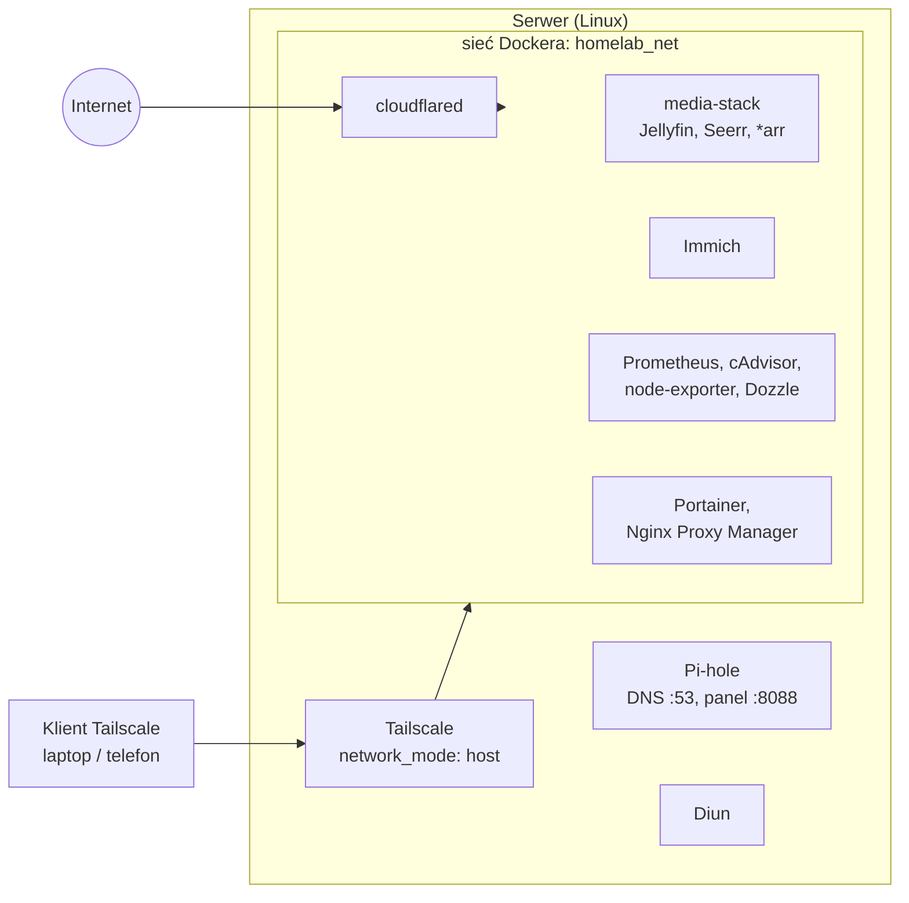

# homelab

Konfiguracja domowego serwera oparta w całości na **Docker Compose**. Każda usługa to osobny stos w swoim katalogu, więc można ją uruchamiać, aktualizować i usuwać niezależnie od pozostałych.

> Repozytorium nie zawiera haseł, tokenów ani danych aplikacji. Sekrety trafiają do plików `.env`, które są wykluczone z Gita (zob. [Sekrety](#sekrety)).

## Co tu jest

- **Zdjęcia i wideo**: Immich, samodzielnie hostowana alternatywa dla Google Photos
- **Multimedia**: Jellyfin oraz automatyzacja biblioteki (Sonarr, Radarr, Prowlarr, Bazarr, qBittorrent)
- **DNS z blokadą reklam**: Pi-hole
- **Monitoring**: Prometheus, cAdvisor, node-exporter, Dozzle
- **Dostęp zdalny**: Tailscale (prywatny VPN) i tunel Cloudflare (publiczny)
- **Administracja**: Portainer, Nginx Proxy Manager, Diun (powiadomienia o nowych wersjach obrazów)

## Architektura

Prawie wszystkie stosy są podłączone do jednej zewnętrznej sieci Dockera `homelab_net`, w której kontenery widzą się po nazwach. Tailscale działa w sieci hosta, a Pi-hole i Diun mają własne, domyślne sieci. W stosie Immich w `homelab_net` jest tylko serwer. Baza, Redis i uczenie maszynowe siedzą w prywatnej sieci `immich_internal`.



## Usługi i porty

Porty z `BIND_IP` mają postać `${BIND_IP:-0.0.0.0}:port:port`. Jeśli usługa jest dostępna tylko wewnątrz `homelab_net`, w kolumnie portu stoi „wewn.”.

| Usługa | Katalog | Port | Opis |
|---|---|---|---|
| **Jellyfin** | `media-stack` | 8096 | Serwer multimediów, z dostępem do `/dev/dri` (transkodowanie sprzętowe) |
| **Seerr** | `media-stack` | 5055 | Zgłaszanie próśb o nowe tytuły |
| **Sonarr** | `media-stack` | 8989 | Automatyzacja seriali |
| **Radarr** | `media-stack` | 7878 | Automatyzacja filmów |
| **Prowlarr** | `media-stack` | 9696 | Menedżer indeksatorów |
| **Bazarr** | `media-stack` | 6767 | Napisy |
| **qBittorrent** | `media-stack` | 8081, 6881 (TCP/UDP) | Klient pobierania |
| **FlareSolverr** | `media-stack` | wewn. (8191) | Pomocnik dla stron z zabezpieczeniem przed botami |
| **MeTube** | `media-stack` | 9999 | Pobieranie wideo przez przeglądarkę |
| **Immich** | `immich` | 2283 | Zdjęcia i wideo (serwer, uczenie maszynowe, PostgreSQL, Valkey) |
| **Prometheus** | `monitoring` | 9090 | Metryki i reguły alertów |
| **cAdvisor** | `monitoring` | wewn. (8080) | Metryki kontenerów |
| **node-exporter** | `monitoring` | wewn. (9100) | Metryki maszyny |
| **Dozzle** | `monitoring` | 8888 | Logi kontenerów na żywo |
| **Portainer** | `portainer` | 9443 | Zarządzanie kontenerami (HTTPS) |
| **Nginx Proxy Manager** | `nginx-proxy-manager` | 80, 81 (panel), 443 | Wewnętrzny reverse proxy |
| **Pi-hole** | `pihole` | 53 (TCP/UDP), 8088 (panel) | DNS blokujący reklamy |
| **Tailscale** | `tailscale` | sieć hosta | VPN, router podsieci `192.168.100.0/24` |
| **cloudflared** | `cloudflared` | brak | Tunel Cloudflare, trasy ustawia się w panelu Cloudflare |
| **Diun** | `diun` | brak | Co 6 godzin sprawdza nowe wersje obrazów i pisze na Telegram |

Jellyfin, Sonarr, Radarr, Bazarr i qBittorrent montują ten sam katalog `DATA_ROOT` jako `/data`, dzięki czemu pobrane pliki trafiają do biblioteki bez kopiowania. Konfiguracje usług leżą w podkatalogach `CONFIG_ROOT` (Seerr trzyma ją w `jellyseerr`, nazwa z wcześniejszej wersji aplikacji).

## Dyski i podział pamięci

Serwer ma dysk systemowy z LVM oraz dwa dyski dodatkowe: jeden na dane Immich, drugi (karta SD) na kopie zapasowe.

| Punkt montowania | Urządzenie | Rozmiar | Zajęte | Przeznaczenie |
|---|---|---|---|---|
| `/` | LVM `ubuntu-vg/ubuntu-lv` | 455 GB | 270 GB (62%) | System, Docker (obrazy, wolumeny), to repozytorium, konfiguracje usług oraz filmy i seriale (`media-stack/data`) |
| `/boot` | `sda2` | 2,0 GB | 239 MB (14%) | Jądro i initramfs |
| `/boot/efi` | `sda1` | 1,1 GB | 6,4 MB (1%) | Partycja EFI |
| `/mnt/dane_120` | `sdb1` | 110 GB | 12 GB (12%) | Dane Immich (zdjęcia i wideo) |
| `/mnt/karta_sd` | `sdc1` | 118 GB | 4,8 GB (5%) | Kopie zapasowe (`/mnt/karta_sd/backupy`) |

Stan z dnia 2026-10-27, wg `df -h`.

Co gdzie leży:

```
/                        system + Docker (/var/lib/docker) + ~/homelab (w tym media-stack/data)
/mnt/dane_120            biblioteka Immich (UPLOAD_LOCATION w immich/.env)
/mnt/karta_sd/backupy    archiwa homelab_config_RRRR-MM-DD_GG-MM.tar.gz
```

Alerty `LowDiskSpace`, `FilesystemReadOnly` i `DiskMountMissing` obejmują `/`, `/mnt/dane_120` i `/mnt/karta_sd`.

## Szybki start

### Wymagania

- Linux z Dockerem i wtyczką Docker Compose v2
- konto Tailscale (dostęp zdalny) i opcjonalnie konto Cloudflare z tunelem (publikacja usług)
- urządzenie `/dev/dri` dla Jellyfin (na maszynie bez GPU usuń sekcję `devices` w `media-stack/docker-compose.yml`)
- urządzenie `/dev/net/tun` dla Tailscale

### Uruchomienie

```bash
git clone https://github.com/patrykludwin02/homelab.git
cd homelab

# wspólna sieć dla stosów
docker network create homelab_net

# pliki ze zmiennymi (powtórz dla każdej usługi, która ma .env.example)
cp media-stack/.env.example media-stack/.env

# kolejno VPN i DNS, potem reszta
cd tailscale && docker compose up -d && cd ..
cd pihole    && docker compose up -d && cd ..
cd media-stack && docker compose up -d
```

Stan stosu sprawdzisz poleceniem `docker compose ps` w jego katalogu.

**Tailscale** nie dostaje klucza w konfiguracji. Po pierwszym starcie zaloguj kontener linkiem z logów (`docker compose logs tailscale`). Kontener ogłasza podsieć `192.168.100.0/24`, więc trasę trzeba jeszcze zatwierdzić w panelu Tailscale, a na hoście musi być włączone przekazywanie pakietów (`net.ipv4.ip_forward=1`).

## Zmienne środowiskowe

Tu są tylko nazwy i przykładowe wartości z plików `.env.example`.

| Zmienna | Używana przez | Opis |
|---|---|---|
| `BIND_IP` | media-stack, immich, monitoring, nginx-proxy-manager, portainer | Adres, na którym nasłuchują porty (domyślnie `0.0.0.0`) |
| `TZ` | media-stack, immich, pihole, diun | Strefa czasowa, np. `Europe/Warsaw` |
| `PUID`, `PGID` | media-stack | Użytkownik i grupa właściciela plików (np. `1000`) |
| `RENDER_GID` | media-stack | GID grupy `render` na hoście (`getent group render`), dla `/dev/dri` w Jellyfin |
| `DATA_ROOT` | media-stack | Katalog z danymi multimedialnymi (np. `/srv/data`) |
| `CONFIG_ROOT` | media-stack | Katalog z konfiguracją usług (np. `/srv/config`) |
| `UPLOAD_LOCATION` | immich | Katalog z biblioteką zdjęć |
| `DB_DATA_LOCATION` | immich | Katalog z danymi PostgreSQL |
| `DB_USERNAME`, `DB_PASSWORD`, `DB_DATABASE_NAME` | immich | Dostęp do bazy |
| `IMMICH_VERSION` | immich | Wersja Immich (domyślnie `release`) |
| `WEBPASSWORD` | pihole | Hasło do panelu (przekazywane też jako `FTLCONF_webserver_api_password`) |
| `TUNNEL_TOKEN` | cloudflared | Token tunelu Cloudflare |
| `TELEGRAM_TOKEN`, `TELEGRAM_CHAT_ID` | diun | Powiadomienia na Telegram |

## Dostęp zdalny i bezpieczeństwo

- **Brak przekierowań portów na routerze.** Dostęp prywatny daje Tailscale, publiczny tunel Cloudflare (połączenie wychodzące).
- **Porty nasłuchują na `0.0.0.0`.** Docker omija reguły zapór takich jak `ufw`, więc ochrona zależy od routera. Zmienną `BIND_IP` można zawęzić do adresu LAN lub Tailscale.
- **Zakres publikacji ustala panel Cloudflare.** `cloudflared` widzi całą sieć `homelab_net`, więc na zewnątrz wystawiaj tylko to, co potrzebne (np. Jellyfin, Seerr).
- **Gniazdo Dockera** (`/var/run/docker.sock`) mają Portainer, Dozzle i Diun. Dwa pierwsze dają pełną kontrolę nad Dockerem, więc nie wystawiaj ich poza sieć domową ani przez tunel bez dodatkowego uwierzytelniania.
- **Obrazy `latest`.** Większość usług nie ma przypiętej wersji. Przypięte hashem są tylko baza i cache Immich, a Diun informuje o nowych wersjach.
- **Healthchecki** mają Immich, Diun, Prometheus oraz Jellyfin, Sonarr, Radarr, Prowlarr, Bazarr i qBittorrent (`docker ps` pokazuje ich stan).

## Monitoring i alerty

Prometheus zbiera metryki co 15 sekund z zadań `prometheus`, `cadvisor` i `node-exporter`. Reguły alertów są w `monitoring/prometheus/alert.rules.yml`:

| Alert | Warunek | Poziom |
|---|---|---|
| `ContainerDown` | kontener niewidoczny dla cAdvisora dłużej niż 60 s, przez 2 min | krytyczny |
| `TargetDown` | zadanie Prometheusa nie odpowiada (`up == 0`) przez 2 min | krytyczny |
| `HighCPUUsage` | CPU powyżej 90% przez 5 min | ostrzeżenie |
| `HighMemoryUsage` | RAM powyżej 90% przez 5 min | ostrzeżenie |
| `LowDiskSpace` | mniej niż 10% wolnego miejsca na `/`, `/mnt/dane_120` lub `/mnt/karta_sd` przez 5 min | krytyczny |
| `FilesystemReadOnly` | jeden z tych systemów plików przeszedł w tryb tylko do odczytu (typowy objaw padającej karty SD) | krytyczny |
| `DiskMountMissing` | `/mnt/dane_120` lub `/mnt/karta_sd` nie jest zamontowany | krytyczny |

Alerty są widoczne w panelu Prometheusa (`:9090/alerts`). Stos nie zawiera Alertmanagera, więc powiadomienia nigdzie nie są wysyłane (zob. [Znane ograniczenia](#znane-ograniczenia)).

## Kopie zapasowe

Skrypt [`scripts/backup.sh`](scripts/backup.sh) zapisuje kopie na karcie SD (`/mnt/karta_sd`). Przerywa działanie przy pierwszym błędzie, a stare archiwa usuwa dopiero po udanym backupie.

1. **Sprawdzenia:** karta SD musi być zamontowana i zapisywalna, a w skrypcie nie może działać druga instancja.
2. **Baza Immich:** `pg_dumpall` skompresowany do `immich/database_dump.sql.gz` (plik jest w `.gitignore`).
3. **Archiwum** `backupy/homelab_config_RRRR-MM-DD_GG-MM.tar.gz` zawiera repozytorium z plikami `.env`, katalog `CONFIG_ROOT` (jeśli leży poza repozytorium, ścieżka jest czytana z `media-stack/.env`) oraz wolumen Portainera. Pomija `media-stack/data`, `immich/postgres` (jest zrzut) i `immich/library` (kopiowana osobno).
4. **Zdjęcia Immich:** `rsync` z `UPLOAD_LOCATION` do `/mnt/karta_sd/immich_library` (bez `thumbs/` i `encoded-video/`, które Immich odtwarza sam). To lustro, więc skasowane zdjęcie znika też z kopii.
5. **Rotacja:** archiwa starsze niż 30 dni są usuwane.

Wymaga `rsync` (`sudo apt install rsync`) i uprawnień do Dockera. Przykładowy wpis crona, codziennie o 3:00:

```
0 3 * * * /home/homelab/homelab/scripts/backup.sh >> /var/log/homelab-backup.log 2>&1
```

Ścieżki i opcje można nadpisać zmiennymi środowiskowymi (`SOURCE_DIR`, `SD_MOUNT`, `DB_CONTAINER`, `DOCKER_VOLUMES`, `RETENTION_DAYS`).

Archiwum zawiera sekrety z plików `.env`, dlatego dostaje uprawnienia `600`. Karta SD stoi w tej samej maszynie co oryginały, więc nie chroni przed pożarem, kradzieżą ani awarią zasilacza. Dla danych, których nie da się odtworzyć (zdjęcia), warto mieć jeszcze kopię poza domem.

### Odtwarzanie bazy Immich

Wg [dokumentacji Immich](https://docs.immich.app/administration/backup-and-restore/): zatrzymaj stos, uruchom sam kontener bazy i wczytaj zrzut.

```bash
cd immich
docker compose down
docker compose create
docker start immich_postgres && sleep 10
gunzip --stdout database_dump.sql.gz \
  | sed "s/SELECT pg_catalog.set_config('search_path', '', false);/SELECT pg_catalog.set_config('search_path', 'public, pg_catalog', true);/g" \
  | docker exec -i immich_postgres psql --dbname=postgres --username=postgres
docker compose up -d
```

## Struktura repozytorium

```
homelab/
├── .github/dependabot.yml  aktualizacje przypiętych obrazów
├── .gitignore
├── README.md
├── cloudflared/            tunel Cloudflare
├── diun/                   powiadomienia o nowych obrazach
├── immich/                 zdjęcia i wideo
├── media-stack/            Jellyfin, Seerr, *arr, qBittorrent, FlareSolverr, MeTube
├── monitoring/             Prometheus, cAdvisor, node-exporter, Dozzle
│   └── prometheus/         prometheus.yml, alert.rules.yml
├── nginx-proxy-manager/    reverse proxy
├── pihole/                 DNS z blokadą reklam
├── portainer/              zarządzanie kontenerami
├── scripts/                backup.sh (kopie zapasowe)
└── tailscale/              VPN
```

Każdy katalog usługi zawiera `docker-compose.yml`, a większość także `.env.example` (wyjątek: `tailscale/`).

## Sekrety

- Pliki `.env` i `*.env` są ignorowane przez Git, z wyjątkiem `.env.example` z wartościami zastępczymi.
- W `.gitignore` są też dane aplikacji: bazy i certyfikaty (`*.db`, `*.sqlite*`, `*.pem`, `*.key`, `*.crt`, `*.sql`, `*.dump`), katalogi `data/`, `state/`, `config/`, `logs/`, `files/` oraz dane Pi-hole, Nginx Proxy Manager i Immich.
- Jeśli jakiś sekret kiedykolwiek trafił do historii, **unieważnij go i wygeneruj nowy**. Samo usunięcie pliku nie usuwa go z historii.

## Znane ograniczenia

- **Brak powiadomień o alertach:** reguły z `alert.rules.yml` działają, ale widać je tylko w panelu Prometheusa, bo stos nie zawiera Alertmanagera.
- **Jellyfin:** `/dev/dri` jest mapowane bezwarunkowo. Identyfikator grupy `render` ustawia `RENDER_GID`. Oficjalny obraz Jellyfin ignoruje `PUID` i `PGID`.
- **Pi-hole w sieci bridge:** w logach zapytań klienci mogą wyglądać jak adres bramy Dockera, więc statystyki per urządzenie są mniej dokładne. Samo filtrowanie działa poprawnie.
- **Brak limitów zasobów:** żaden kontener nie ma ustawionych limitów pamięci ani CPU.
- **Wersje obrazów:** większość usług używa tagu `latest`. Dependabot (`.github/dependabot.yml`) zacznie zgłaszać aktualizacje dopiero dla obrazów z przypiętym tagiem.

## Licencja

Dowolne wykorzystanie na własną odpowiedzialność. Używane aplikacje mają własne licencje.
